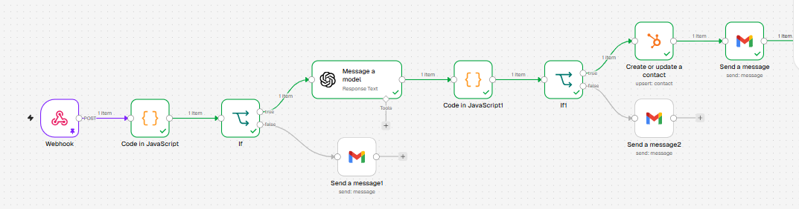
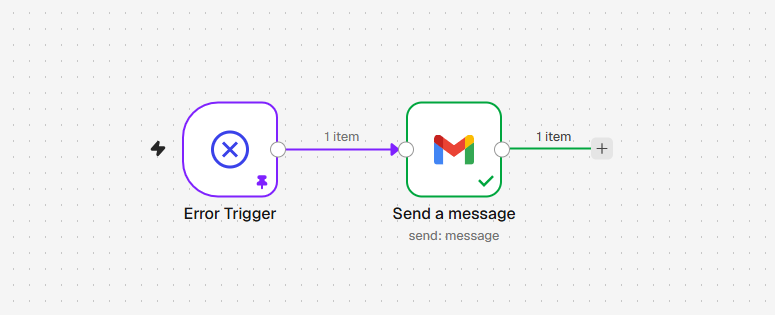

# PrimeHome Realty — AI-Powered Real Estate Lead Management

An AI automation portfolio project built with **n8n, OpenAI, HubSpot, Gmail, webhooks, and JavaScript**.

Automatically validate property enquiries, assess buyer intent, route leads according to qualification status, update CRM contacts, and notify the relevant team.

> **Project type:** Portfolio demonstration using a fictional real estate company. This project demonstrates hands-on automation skills and is not presented as a deployment for a paying client.

## Overview

Real estate agencies receive enquiries from prospective buyers with different budgets, preferences, and purchase timelines. Manually reviewing and organizing these enquiries can create repetitive administrative work and make consistent lead handling more difficult.

This project demonstrates an automated approach to the initial lead management process.

The workflow receives property enquiries, validates contact information, uses AI to assess buying intent, routes leads according to their qualification status, updates HubSpot for qualified leads, and sends email notifications.

A separate error-handling workflow sends email alerts when workflow executions fail.

## Business Problem

The workflow addresses common operational challenges:

- Incomplete or invalid lead information.
- Manual review of incoming property enquiries.
- Inconsistent lead qualification.
- Repetitive CRM data entry.
- Delayed internal notifications.
- Limited visibility into workflow failures.

## Workflow Demonstration

### Main n8n Workflow


The main workflow connects webhook intake, data validation, AI qualification, conditional routing, HubSpot CRM updates, and Gmail notifications.

### Successful Execution



This screenshot provides evidence of a successful workflow execution during testing.

### Error-Handling Workflow



A separate workflow listens for configured workflow failures and sends an email alert containing available execution and error details.

## How It Works

1. **Lead intake:** An HTTP POST webhook receives a property enquiry.
2. **Data validation:** JavaScript checks required fields and email format.
3. **AI qualification:** OpenAI analyses the enquiry and generates structured qualification data.
4. **Output validation:** The workflow checks required AI-generated fields and the lead score.
5. **Conditional routing:** Leads follow different paths according to validation and qualification results.
6. **CRM integration:** Qualified leads are created or updated in HubSpot, using email to identify the contact.
7. **Email notifications:** Gmail sends notifications for qualified leads, invalid submissions, and other qualification outcomes.
8. **Error alerts:** A separate error-handling workflow sends notifications when a configured workflow execution fails.

## Key Features

### Webhook Integration

Receives property enquiries through an HTTP POST endpoint.

### JavaScript Validation

Checks required contact information and email format before processing continues.

### AI-Powered Lead Qualification

Uses OpenAI to extract and assess:

- Buying intent.
- Property type.
- Preferred location.
- Budget range.
- Purchase timeline.
- Lead score from 0 to 100.
- Qualification status.
- Recommended next action.

### Conditional Routing

Separates invalid submissions, qualified leads, and other qualification outcomes.

### HubSpot CRM Integration

Creates or updates qualified contacts and maps relevant lead information to CRM fields.

### Automated Email Notifications

Sends notifications for qualified leads, invalid submissions, and other qualification outcomes.

### Error Handling

Uses a separate n8n error workflow to send email alerts when configured workflow executions fail.

## Technology Stack

| Technology | Purpose |
|---|---|
| n8n | Workflow orchestration |
| Webhooks | Incoming lead capture |
| JavaScript | Input validation and AI output processing |
| OpenAI | AI-assisted lead qualification |
| HubSpot | CRM contact management |
| Gmail | Notifications and error alerts |

## Sample Lead

The following fictional enquiry illustrates the type of information the workflow processes.

### Example Input

```json
{
  "name": "Sarah Johnson",
  "email": "sarah.johnson@example.com",
  "phone": "+2348012345678",
  "location": "Lekki Phase 1, Lagos",
  "budget": "60000000-100000000 NGN",
  "message": "I am looking for a 3-bedroom apartment in Lekki Phase 1 with a budget of 80000000 NGN. I would like to arrange a viewing this weekend and hope to buy within two weeks."
}
```

### Example AI Output

```json
{
  "buying_intent": "high",
  "property_type": "3-bedroom apartment",
  "location": "Lekki Phase 1",
  "budget_min": 60000000,
  "budget_max": 100000000,
  "timeframe": "within two weeks",
  "lead_score": 90,
  "qualification_status": "Qualified",
  "recommended_action": "Set up property viewings"
}
```

This is an illustrative example of structured AI output, not a guarantee that every enquiry will produce the same result.

## Testing and Verification

The following behaviors have been tested:

- Valid enquiries proceeding through the workflow.
- Invalid email submissions being rejected and reported.
- Qualified leads being saved to HubSpot and generating email notifications.
- Other qualification outcomes generating their corresponding notifications.
- Repeat submissions using the same email updating the existing HubSpot contact in the tested scenario.
- A separate test workflow deliberately failing and triggering the configured error-handling workflow.

Recent main-workflow executions checked during verification showed successful results.

**Testing note:** The deliberate failure test used a separate test workflow configured to use the error-handling workflow.

## How to Review the Project

The live n8n workflow is not publicly accessible. You can review the implementation through the documentation and screenshots in this repository.

1. Review the workflow screenshots above.
2. Examine the sample lead input and structured AI output.
3. Follow the workflow architecture and feature descriptions.
4. Review the documented testing scenarios.

## Demo Video

Watch the full project demonstration:

[PrimeHome Realty — AI-Powered Real Estate Lead Management & Automation System](https://www.loom.com/share/fdaea6c36892417fbacd4cb74adff815)

## Limitations and Future Improvements

Potential improvements include:

- Preventing duplicate notifications for repeated submissions.
- Storing lead history in a database.
- Implementing controlled follow-up sequences.
- Adding human approval for uncertain AI assessments.
- Introducing retry logic for temporary integration failures.
- Expanding automated tests and monitoring.
- Adding reporting dashboards for lead processing.

AI-generated qualification scores support prioritization; they do not guarantee that a prospect will purchase a property.

## Security Considerations

Before sharing workflow exports or screenshots publicly:

- Remove API keys, access tokens, and credentials.
- Remove private webhook URLs and sensitive configuration.
- Use fictional contact information in public examples.
- Never commit active credentials or `.env` files.

## What This Project Demonstrates

This portfolio project demonstrates practical experience with:

- n8n workflow development.
- Webhook-based integrations.
- JavaScript data validation.
- OpenAI structured output processing.
- Conditional workflow routing.
- HubSpot CRM integration.
- Gmail notifications.
- Workflow error handling and testing.

The project is intended to demonstrate technical capabilities and provide a foundation for similar business automation solutions.

## Interested in a Similar Automation?

I build AI-assisted business workflows that help organize incoming enquiries, automate repetitive processes, and connect business tools.

If your real estate agency needs help with lead qualification, CRM updates, enquiry routing, or email notifications, feel free to connect with me.

## Contact

Interested in working together on AI automation projects?

- **Email:** onyekachiopk@gmail.com
- **LinkedIn:** [Prince Onyekachi](https://www.linkedin.com/in/prince-onyekachi-b2405a3b2/)
- **GitHub:** [prince-onyekachi](https://github.com/prince-onyekachi)

I'm open to discussing AI automation projects involving n8n, OpenAI, lead qualification, CRM integrations, and business process automation.

If you're looking to automate repetitive business processes, improve lead management, or connect your existing business tools, feel free to reach out.

---

*Built as an AI automation portfolio project by Prince Onyekachi.*
