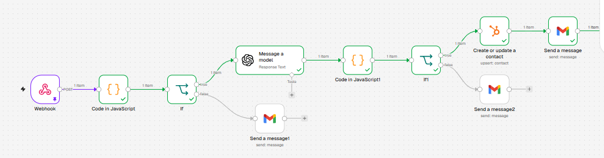
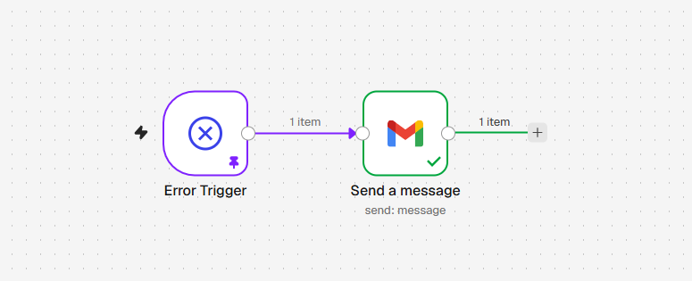
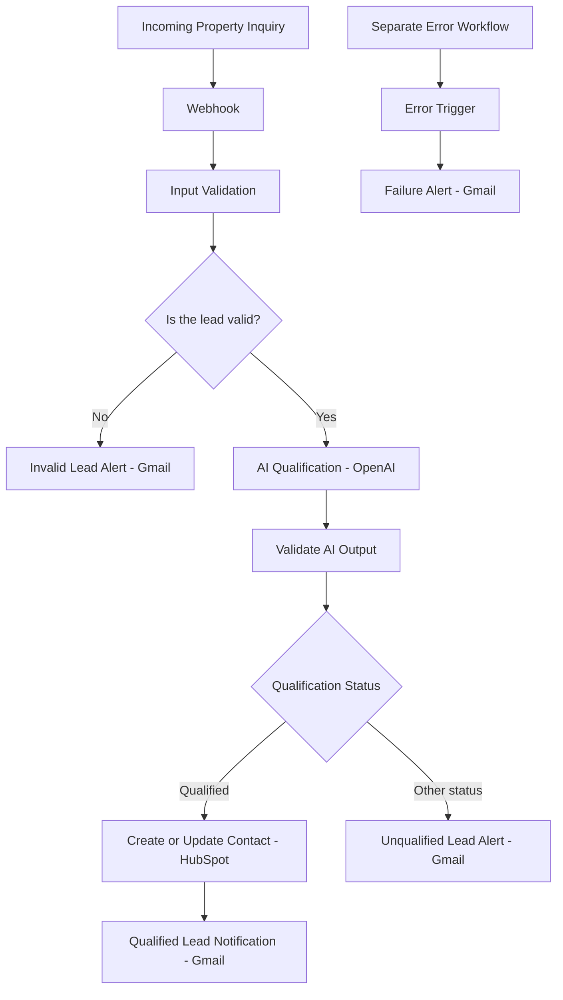

# PrimeHome Realty — AI Lead Management System

An AI-powered real estate lead management automation built with n8n, OpenAI, HubSpot, and Gmail.

## Project Overview

PrimeHome Realty is a fictional real estate business used to demonstrate practical AI automation skills.

This project automates the initial handling of property inquiries, validates incoming lead data, uses AI to assess buyer intent, routes leads according to their qualification status, updates the CRM for qualified leads, and sends email notifications.

A separate error-handling workflow sends email alerts when workflow executions fail.

## Business Problem

Manually processing property inquiries can lead to:
- Invalid or incomplete contact information.
- Delays in identifying serious buyers.
- Inconsistent lead qualification.
- Missed CRM updates and follow-ups.
- Limited visibility into automation failures.

This system demonstrates how workflow automation can reduce repetitive administrative tasks and support more consistent lead management.

## Workflow Architecture

### Main n8n Workflow


### Successful Execution



### Error-Handling Workflow





A separate error-handling workflow listens for workflow failures and sends Gmail alerts.

## Key Features

### 1. Webhook Lead Intake
Receives property inquiries through an HTTP POST webhook.

### 2. Input Validation
JavaScript checks required fields and email format before the inquiry proceeds.

### 3. AI Lead Qualification
OpenAI assesses:
- Buying intent.
- Property type and preferred location.
- Budget range.
- Purchase timeline.
- Lead score from 0 to 100.
- Qualification status.
- Recommended next action and reasoning.

### 4. Conditional Routing
The workflow routes invalid submissions, qualified leads, and other qualification outcomes through separate paths.

### 5. HubSpot CRM Integration
Qualified leads are created or updated in HubSpot using their email address to identify the contact. Relevant contact and property information is mapped to CRM fields.

### 6. Email Notifications
Gmail sends notifications for qualified leads, invalid submissions, and unqualified inquiries.

### 7. Error Handling
A separate n8n workflow sends an email alert containing available execution and error details when a workflow failure occurs.

## Technology Stack

| Technology | Purpose |
|---|---|
| n8n | Workflow orchestration |
| Webhooks | Lead intake |
| JavaScript | Validation and data processing |
| OpenAI | AI-assisted lead qualification |
| HubSpot | CRM contact management |
| Gmail | Notifications and error alerts |

## Testing and Verification

The following behaviors have been tested:
- Valid inquiries proceeding through the workflow.
- Invalid email submissions being rejected and reported.
- Qualified leads being saved to HubSpot and generating email notifications.
- Unqualified leads generating their own notifications.
- Repeat submissions using the same email updating the existing HubSpot contact in the tested scenario.
- The separate error-handling workflow sending an alert after a deliberately failed test workflow.

Recent main-workflow executions checked during verification showed successful results.

**Testing note:** The deliberate failure test used a separate test workflow configured to use the error-handling workflow.

## Sample Input and Output
### Sample Input

The workflow receives a real-estate inquiry through its webhook.

```json
{
  "name": "Sarah Johnson",
  "email": "sarah.johnson@example.com",
  "phone": "+2348012345678",
  "location": "Lekki Phase 1, Lagos",
  "budget": "₦60,000,000–₦100,000,000",
  "message": "I am looking for a 3-bedroom apartment in Lekki Phase 1 with a budget of ₦80,000,000. I would like to arrange a viewing this weekend and hope to buy within two weeks."
}
```
### Sample AI Output

After analysing the inquiry, the AI qualification step produces a structured result:

```json
{
  "buying_intent": "high",
  "property_type": "3-bedroom apartment",
  "location": "Lekki Phase 1",
  "budget_min": 60000000,
  "budget_max": 100000000,
  "timeframe": "within two weeks",
  "lead_score": 90,
  "qualification_status": "Qualified",
  "recommended_action": "Set up property viewings"
}
```

## Limitations and Future Improvements

Potential improvements include:
- Preventing duplicate notifications for repeated submissions.
- Storing lead history in a database.
- Adding controlled follow-up sequences.
- Introducing human approval for uncertain AI assessments.
- Implementing retry logic for temporary integration failures.
- Adding monitoring dashboards and broader failure testing.

AI qualification is an aid to decision-making, not a guarantee that a prospect will purchase a property.

## Security

This repository documents the project. Before publishing workflow exports, remove credentials, API keys, access tokens, private webhook URLs, and personal information. Use fictional test data in public demonstrations.

## Project Outcome

This project demonstrates hands-on practice with webhook integrations, JavaScript validation, AI-assisted classification, conditional routing, CRM integration, email notifications, and error handling.

It is a portfolio demonstration using a fictional real estate company, not a claim of deployment for a real estate client.

## Live Demo / How to Test
This project is documented with workflow screenshots and sample data so visitors can understand how it works without needing access to my n8n account.
### How to Test the Workflow
1. Review the workflow architecture diagram above to understand how the system operates.
2. Examine the sample lead input and AI output to see how incoming property inquiries are processed.
3. View the workflow screenshots to understand the n8n nodes, connections, and execution results.
4. Use the documented test scenarios to understand how qualified, unqualified, and invalid leads are handled.

 Note: The live n8n workflow is not publicly accessible. The screenshots, architecture diagram, and sample data provide a demonstration of the system without requiring access to the original n8n account.
